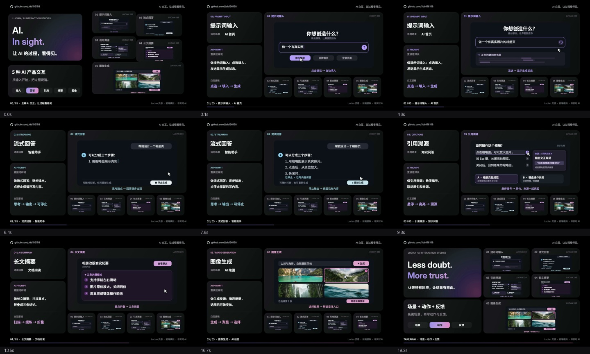

# AI. In sight. — 五种 AI 产品交互

**[打开交互演示网页](https://jdb156158.github.io/vibe-aicheck/)** · [下载 MP4](https://jdb156158.github.io/vibe-aicheck/media/ai-microinteractions-20s.mp4) · [下载完整源码](https://jdb156158.github.io/vibe-aicheck/media/source.zip)

20 秒 · 1920×1080 · 60fps · H.264 + AAC。深色 Bento 布局，五种交互，每种都有 **适用场景 + 可复用 AI 提示词 + 操作演示**。

## 视频展示

点击下方总览播放视频，演示网页中也可直接播放：

[](https://jdb156158.github.io/vibe-aicheck/media/ai-microinteractions-20s.mp4)

## 五种控件

| 控件 | 适用场景 | 可实际操作的反馈 |
|---|---|---|
| 提示词输入 | AI 首页 | 点建议、编辑、发送、取消、完成 |
| 流式回答 | 智能助手 | 思考、输出、停止保留、重新生成 |
| 引用溯源 | 知识问答 | 悬停 / 聚焦 / 点击编号，联动原句和来源 |
| 长文摘要 | 文档阅读 | 扫描标记、三条结论、切回原文 |
| 图像生成 | AI 绘图 | 逐渐清晰、选择候选、查看模拟裁切变体 |

均为本地前端模拟，不调用模型、不上传输入内容。图片使用预置真实摄影，模拟变体是同一照片的不同裁切。

## 提示词

1. 做提示词输入：点选填入，发送显示生成状态。
2. 做流式回答：逐步输出，点停止保留已写内容。
3. 做引用溯源：悬停编号，联动原句和来源。
4. 做长文摘要：扫描重点，折叠成三条结论。
5. 做生成反馈：噪声渐退，选图后可做变体。

**[五条完整实现提示词与视频制作提示词](docs/PROMPTS.md)**。网页左侧可复制完整提示词。

## 制作步骤

1. 查阅 [Lucian UX/UI Prompt](https://lucianlabs.dev/uxui-prompt/) 条目 233、086、224、235、280，截图确认五个同类控件。
2. 编写 [时间码分镜与来源记录](docs/treatment.md)：0–2 秒总览，2–17 秒每种 3 秒，17–20 秒总结“场景 + 动作 + 反馈”。
3. 用 HTML Canvas 独立重绘。`film/index.html` 暴露 `window.draw(t)`，字体和照片完成加载后开始，画面由时间决定。
4. 先检查九帧，迭代两轮：调整停止内容和对比度，延长摘要与选择结果的停留时间。
5. Python 合成 120 BPM、2/4 拍配乐与操作音效，切点对齐小节，终止和弦后淡出。
6. Playwright 导出 1200 张 JPG，ffmpeg 合成 H.264 + AAC，加入 faststart 并检查播放、跳转和音频峰值。
7. 用原生 HTML/CSS/JS 实现五种真正可交互的网页版本，适配移动端、键盘与减少动态效果设置。
8. 上传 GitHub，使用 main 分支根目录发布 GitHub Pages。网页视频为较小的网络播放编码，保持 1080p/60fps。

## 源码结构与运行

- `index.html`、`site/`：交互网页。
- `film/`：视频 Canvas 源码、字体、摄影、配乐和渲染脚本。
- `docs/`：提示词、分镜、制作和 QA 记录。
- `media/`：MP4、总览、源码 ZIP。

网页本地运行：

```sh
python3 -m http.server 8000
```

然后打开 `http://localhost:8000/`。视频重渲染：

```sh
cd film
npm install
python3 -m pip install numpy
python3 make_audio.py
npm run render
sh encode.sh
```

需要 ffmpeg、Chrome。可用 `CHROME_PATH` 指定 Chrome。ZIP 排除 MP4、可再生 WAV 和逐帧文件，视频单独提供。

署名：[github.com/Jdb156158](https://github.com/Jdb156158)。摄影来源见 [素材清单](film/assets/photo-sources.json)，字体许可随素材交付。
